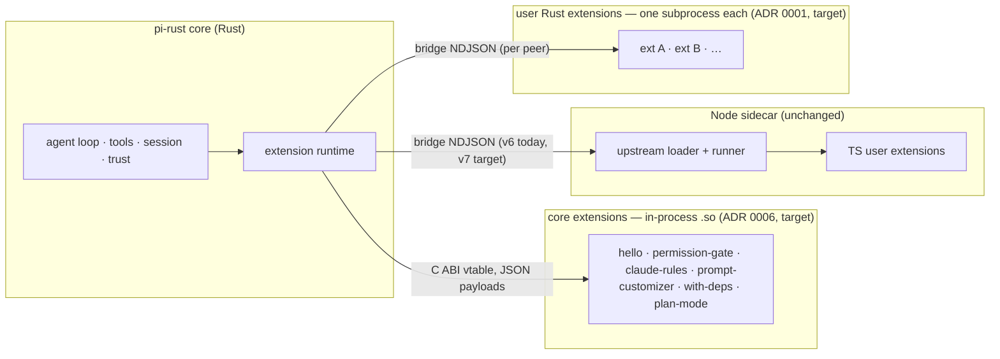

# Architecture — pi-rust

pi-rust is a Rust port of earendil-works/pi. Deployables: the **`pi-rust`
binary** (agent loop, model runtime, built-in tools, session storage, TUI), the
**Node sidecar** (runs the original, unmodified upstream TypeScript extension
loader/runner), and — target state, E1S2–E1S5 — **core extensions** (Rust
`.so`/`.dll`/`.dylib`, in-process) and **user Rust extensions** (Rust
subprocesses). Decisions are recorded in [`adr/`](./adr/); the plan lives in
[`epics.md`](./epics.md).

## Topology



- **Core (Rust):** agent loop and model runtime ([src/agent.rs](https://github.com/ripmav/pi-rust/blob/main/src/agent.rs)),
  built-in tools ([src/tools.rs](https://github.com/ripmav/pi-rust/blob/main/src/tools.rs)),
  sessions ([src/session.rs](https://github.com/ripmav/pi-rust/blob/main/src/session.rs)),
  trust ([src/trust.rs](https://github.com/ripmav/pi-rust/blob/main/src/trust.rs)), TUI ([src/tui/](https://github.com/ripmav/pi-rust/tree/main/src/tui)).
  Loads `<agentDir>/models.json` natively (E3S1, JSONC) and serves its
  OpenAI-compatible providers through the built-in driver — a Node-free run.
  The core never streams models of *extension*-registered providers itself.
- **Sidecar (Node):** spawned next to the binary
  ([`find_sidecar`](https://github.com/ripmav/pi-rust/blob/main/src/cli.rs),
  override `PI_RUST_SIDECAR`); runs the unmodified upstream loader/runner;
  never talks to a model.
- **Bridge:** NDJSON over stdio,
  [bridge protocol v6](./bridge-protocol.md) — handshake with
  `protocolVersion` + capability negotiation, `ready` catalog
  (tools/commands/shortcuts/flags/providers/events), blocking "decision"
  commands and fire-and-forget events, `Running`/`Degraded`/`Stopped` peer
  state ([src/client.rs](https://github.com/ripmav/pi-rust/blob/main/src/client.rs)).

## Extension path — current (TS via sidecar)

- **Discovery** (by the sidecar, upstream rules): `<cwd>/.pi/extensions`
  (project scope), agent dir (`PI_CODING_AGENT_DIR`), `--extension-dir`
  entries.
- **Trust:** WP-1102 — untrusted project-scope content has zero behavioral
  effect; the core sends the resolved decision as `init.projectTrusted` and
  the sidecar excludes untrusted project-scope TS extensions. WP-1103: trusted
  project `.pi/` config (settings, MCP) is applied by the core and passed via
  `init`.
- **Degradation:** sidecar crash or unanswered blocking command → `Degraded`
  (extension tools dropped, decisions resolve to protocol defaults, no
  respawn); clean shutdown or failed handshake → `Stopped`. E3S1: a
  **spawn failure is also `Stopped` and not fatal** — the run continues
  Node-free (built-ins + core-native models.json providers).

## Extension runtime — target state (E1S2–E1S5, not yet implemented)

### Core extensions (in-process, ADR 0005 + ADR 0006)

- The six bridge-matrix ports, one cdylib each: `libpi-ext-<name>` for
  `hello`, `permission-gate`, `claude-rules`, `prompt-customizer`,
  `with-deps`, `plan-mode`. Packed into the release alongside the binary.
- Install layout (relative to the binary, like the sidecar):
  `<install>/core-ext/libpi-ext-<name>.{so,dylib,dll}` +
  `<install>/core-ext/manifest.json` (name, `apiVersion`, sha256 per
  library); override dir `PI_RUST_CORE_EXT_DIR` (mirrors `PI_RUST_SIDECAR`).
- Load: after config + trust resolution, before the first session event;
  `dlopen` in name order; sha256 verified against the manifest (mismatch →
  refuse that extension, log); ABI version checked
  (`PI_EXT_CORE_API_VERSION = 1`).
- **C ABI:** one entry point, `pi_ext_core_init_v1(const PiCoreApi*) -> int`.
  `PiCoreApi` is a fixed C struct of function pointers mirroring the bridge
  command surface: `register_tool`, `on(event)`, `register_command`,
  `register_shortcut`, `register_flag`/`get_flag`, `ui_request`,
  `send_user_message`, `append_entry`, `set_active_tools`, `exec`, … The
  extension keeps its state behind an opaque `user_data` pointer.
- **Payloads cross as JSON** — the same wire types the bridge uses (one
  source of truth in `pi-ext`, ADR 0003): the in-process transport replaces
  stdio with function pointers, nothing else. Decision handlers return
  `result_json` (or null); fire-and-forget handlers return nothing.
- **Fault boundary:** every core→extension call is wrapped in
  `catch_unwind`; a faulted extension is marked, skipped for the rest of the
  session and logged (memory faults are not catchable — accepted per ADR 0006;
  CI dlopen test + full suite gate these libraries instead).

### User Rust extensions (subprocess, ADR 0001)

- **Discovery is owned by the core** (target): it scans the same three
  locations and classifies each candidate — a directory with a `pi-ext.toml`
  manifest → Rust peer; TS shapes → sidecar list.
- **Manifest** (`<ext-dir>/<name>/pi-ext.toml`):
  ```toml
  name = "my-ext"
  description = "..."
  bin = "my-ext"          # executable in this dir (string), or a [bin] table keyed by target triple
  ```
- **Runtime:** one process per extension, spawned at startup in parallel,
  bridge protocol over its stdio with the same `init`/`ready` handshake and
  per-peer `Running`/`Degraded`/`Stopped` semantics (no respawn).
- **Protocol v7** (delta over v6, ships with the core): `init` gains
  `extensions: [{ path, kind: "ts" }]` — the core sends the explicit TS list
  and the sidecar loads exactly that (no own discovery). Everything else v6.

### Event flow (target)

- **Fire-and-forget events:** fanned out to core extensions and to every
  subscribed peer (per `ready.events`), as today.
- **Decision events** (`tool_call`, `before_agent_start`, …): handlers run in
  a fixed order — core extensions (name order) → sidecar → user Rust peers
  (path-sorted). The first `block` wins; other results combine in order
  (bridge combination semantics).
- **Tool set:** tools from all sources merge into the model's tool set; a
  name collision across sources drops the later source's tool and logs a
  diagnostic.
- **UI:** one dialog round-trip for the sidecar (today's
  `extension_ui_request`); user Rust peers use the protocol's `ui`
  capabilities; core extensions call the vtable `ui_request` synchronously
  (core routes to the TUI or applies the headless default).

## Workspace layout

```
pi-rust/
├── Cargo.toml        # [workspace] + root binary crate `pi-rust` (existing paths unchanged)
├── src/              # core
├── sidecar/          # Node sidecar (unchanged in E1)
├── pi-ext/           # public API crate (ADR 0003): pi+ctx surface (ADR 0002),
│                     #   bridge wire types, v6 process client (user target),
│                     #   core vtable binding (cdylib target)
└── core-ext/         # the six core extensions, one cdylib crate each (ADR 0005)
    ├── hello/  permission-gate/  claude-rules/
    └── prompt-customizer/  with-deps/  plan-mode/
```

## Release & install

One packed payload per target: binary + `sidecar/` + `core-ext/` (libraries +
manifest); `install.sh` unpacks it. CI must `dlopen` each core library in a
host process and run its suite before release.

## Cross-cutting

- **Config:** `PI_CODING_AGENT_DIR`, `PI_RUST_SIDECAR`, `PI_RUST_CORE_EXT_DIR`
  (new), `--extension-dir`, `<cwd>/.pi/`.
- **Trust:** WP-1102 gate applies to user extensions of both kinds
  (project-scope inert until trusted); core extensions are first-party and
  trusted by definition (ADR 0005, ADR 0006).
- **Logging:** protocol on stdout only; everything else on stderr via
  [src/corelog.rs](https://github.com/ripmav/pi-rust/blob/main/src/corelog.rs).
- **Build/CI** (the checks every PR must pass): `test` (OS matrix incl.
  Windows), `clippy`, `rustfmt`, `bench` (baseline compare,
  [benches/baseline.json](https://github.com/ripmav/pi-rust/blob/main/benches/baseline.json)),
  `fresh-clone` (README in a clean container). E1 adds: workspace build,
  `pi-ext` doc tests + catalog↔API parity test, CI dlopen test for the core
  libraries, and the `--bench` loop re-run against a Rust peer (E1S3).

## ADRs

| ADR | Decision | Status |
|---|---|---|
| [ADR 0001](./adr/0001-rust-extensions-as-bridge-subprocesses.md) | User Rust extensions run as per-extension subprocesses over bridge v6 | superseded for the core scope by ADR 0006 |
| [ADR 0002](./adr/0002-mirror-full-upstream-extension-api.md) | Full 1:1 mirror of the upstream `pi` + `ctx` API, parity test | accepted |
| [ADR 0003](./adr/0003-workspace-with-pi-ext-crate.md) | Cargo workspace; public `pi-ext` crate; shared wire types | accepted |
| [ADR 0004](./adr/0004-rust-extensions-share-discovery-and-trust.md) | Rust user extensions discovered in the existing locations under the same trust gate | accepted |
| [ADR 0005](./adr/0005-bridge-matrix-ports-as-core-extensions.md) | Six bridge-matrix ports as bundled core extensions | accepted |
| [ADR 0006](./adr/0006-core-extensions-load-in-process-as-so.md) | Core extensions packed into the release, loaded in-process as `.so` | accepted |
